  

  

  

    
    
    
  

---

### 👨‍💻 Sobre mí

Soy **Andrey Julián Ricaurte Duran**, Desarrollador de Software formado en **CampusLands (Bucaramanga, Colombia)**, especializado en el diseño de **arquitectura de software**, modelado de **bases de datos relacionales** y desarrollo de aplicaciones **web y de escritorio** (Frontend & Backend).

- 🏗️ **Lo que construyo:** Aplicaciones web modernas, servicios backend en **Java** y **Python**, esquemas SQL normalizados (**PostgreSQL / MySQL**), automatizaciones e integraciones de APIs.
- 🧠 **Enfoque técnico:** Código limpio, separación por capas / *Bounded Contexts* (DDD), trazabilidad de datos y excelente comunicación en equipo.
- 🎯 **Objetivo actual:** Aportar lógica sólida, eficiencia técnica y evolución constante en equipos de desarrollo de software.
- 📫 **Contacto directo:** [andreyricaurte10@gmail.com](mailto:andreyricaurte10@gmail.com)

---

### 🛠️ Stack Tecnológico & Herramientas

#### Lenguajes & Desarrollo Web

#### Bases de Datos, DevOps & Entorno

---

### 🚀 Proyectos Destacados

| Proyecto | Descripción | Tecnologías | Enlace |
| :--- | :--- | :--- | :---: |
| 🌐 **Portafolio Profesional** | Portafolio interactivo bilingüe (ES/EN) con visualizaciones en Canvas, diagrama de arquitectura interactivo y modo oscuro. | `JavaScript` `HTML5` `CSS3` | [Ver Repo](https://github.com/juliand06/Portafolio_AndreyRicaurte--1-) |
| 🛠️ **Renta de Herramientas y Construcción** | Aplicación web para gestión de catálogo, reservas y alquiler de herramientas y maquinaria de construcción. | `JavaScript` `HTML5` `CSS3` | [Ver Repo](https://github.com/juliand06/rentaherramientas_equiposconstruccion) |
| 🏥 **CareLink — Bounded Contexts** | Sistema diseñado bajo principios de arquitectura limpia y diseño guiado por el dominio (*Domain-Driven Design* / Bounded Contexts). | `Java` `Arquitectura` `DDD` | [Ver Repo](https://github.com/juliand06/carelink_bounendcontexts) |
| 🏥 **CareLink Backend** | Implementación backend principal del ecosistema CareLink desarrollada en Java. | `Java` `Backend` `POO` | [Ver Repo](https://github.com/juliand06/carelink) |
| 🗄️ **Examen & Consultas PostgreSQL** | Esquema relacional normalizado, funciones, triggers y consultas avanzadas en PL/pgSQL. | `PostgreSQL` `PL/pgSQL` `SQL` | [Ver Repo](https://github.com/juliand06/exam-postgres) |
| 🐳 **Taller Reservas PostgreSQL** | Modelado relacional de sistema de reservas desplegado con contenedores Docker y PostgreSQL. | `PostgreSQL` `Docker` `SQL` | [Ver Repo](https://github.com/juliand06/TallerReservasPostgreSQL) |

---

### 📊 Estadísticas en GitHub

  
  

  

---

  

